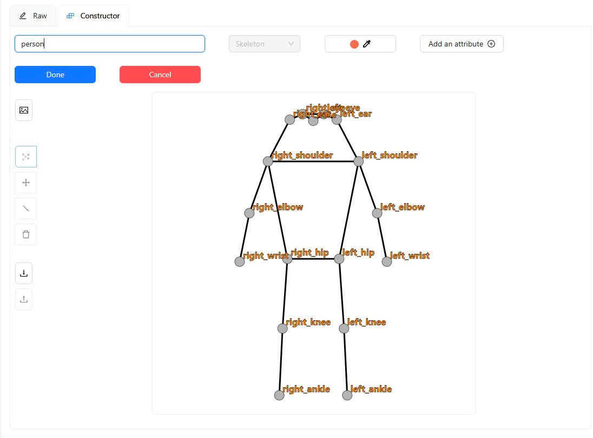
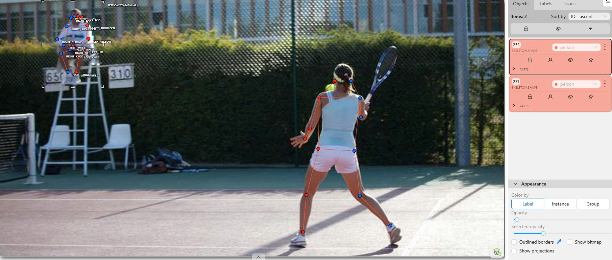
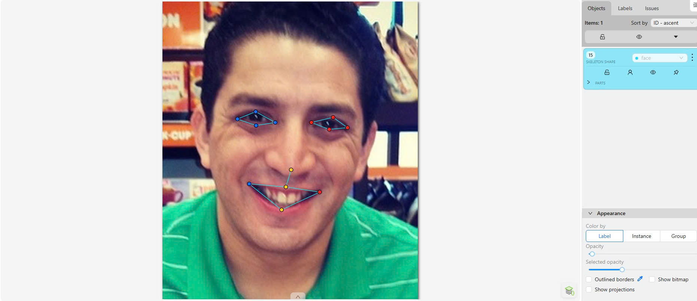
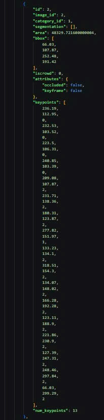

# Báo cáo cá nhân — HoVaTen-MSSV

Đổi tên file theo quy tắc `MSSV_HoTen.md`. Ví dụ: `20241234_NguyenVanAn.md`.

Dữ liệu: 12 ảnh người COCO val2017 (Lin et al., 2014) và 8 ảnh chân dung Wikimedia Commons, chỉ dùng trong lớp.

## 0. Thông tin học viên

- Họ tên: Nguyễn Công Bảo Long
- MSSV: 2A202603297
- Email: blong8444@gmail.com
- Link repository: https://github.com/NguyenCongBaoLong/K5-L2B-Day04-NguyenCongBaoLong-2A202603297-KeypointPose-Student
- Phiên bản CVAT (Help → About): Server version: 2.74.1 · UI version: 2.74.1
- Máy: hệ điều hành Windows 11 · RAM 8 GB · chạy CVAT chế độ lite
- Bộ ảnh (`src/exports/assignment.json` do `lab.py setup` tạo): có 
- Giờ bắt đầu: 16:00
- Giờ kết thúc: 19:00

## 1. Kiểm tra label (CP0)

| Label | Kiểu | Số điểm | Tên điểm đúng bảng của lab? | Đúng thứ tự? | Số cạnh |
|---|---|---:|---|---|---:|
| `person` |Skeleton |17 |Có |Có |16 |
| `face` |Skeleton |13 |Có |Có |12 |

Mẫu `person` dựng theo người quay mặt về camera (các điểm `left_*` nằm bên phải khung mẫu)? Có 

Cách đổi cờ `occluded` / `outside` cho **một điểm** trên phiên bản CVAT này (một câu):

Nhấn phím tương ứng trên bàn phím (Q cho occluded/v=1, O cho outside/v=0, D cho normal/v=2).

## 2. Số lượng đã gán và thời gian (CP1, CP2)

| Nhóm ảnh | Số ảnh | Số skeleton đã gán | Số người dưới 60 px (không gán) | Số poster / gương / màn hình bỏ qua | Thời gian (phút) |
|---|---:|---:|---:|---:|---:|
| `easy` | 5 | 5| 0|0 |35 |
| `occluded` | 3 | 7 |0 |0 |30 |
| `back` | 2 |4 |0 |0 |20 |
| `small` | 1 | 3| 2|0 |15 |
| `crowd` | 1 |2| 3|0 |25 |
| `faces` | 8 |8 | 0 |0 |35 |

- Số ảnh người đã xong ở mốc phút 105: 10 / 10
- Thời gian thực tế (phút): CP1 65 · CP2 95 · CP3 20
- Ảnh tốn thời gian nhất là ảnh nào, vì sao?

 Ảnh `000000193879.jpg` (3 skeleton) và `000000522889.jpg` (nhóm crowd), vì có nhiều nhân vật đan xen và tư thế phức tạp nên tốn nhiều thời gian để đo kích thước (>= 60px), ước lượng tọa độ các khớp bị khuất (`v = 1`) và phân biệt hướng trái/phải.

## 3. Bảng ca khó (CP1, CP2)

Mỗi điểm bạn phân vân một dòng, nhất là phân vân giữa `v = 1` và `v = 0`, hoặc không chắc hướng người.

| Ảnh | Người / mặt | Điểm | Cờ đã chọn | Phân vân giữa | Lý do chọn |
|---|---|---|---:|---|---|
|000000189365.jpg |Person 2 |`left_wrist`, `right_wrist` |1 (`occluded`) |`v = 1` và `v = 2` |Hai tay nhân vật bắt chéo trước thân, phần cổ tay bị che khuất một nửa bởi tay áo nhưng vẫn ước lượng chính xác được khớp. |
|face_255797.jpg |Face 1 |`left_eye_pupil`, `right_eye_pupil` |1 (`occluded`) |`v = 1` và `v = 0` |Nhân vật đeo kính râm tối màu che khuất hoàn toàn đồng tử mắt nhưng khung gọng kính định hình rõ vị trí giải phẫu nên chọn `v = 1`. |
|000000522889.jpg | Person 1|`left_ankle`, `right_ankle` |0 (`outside`) |`v = 0` và `v = 1` |Nhân vật đứng sát mép dưới khung hình, phần cẳng chân từ đầu gối trở xuống bị cắt cụt ra ngoài biên ảnh nên chọn `v = 0`. |

## 4. Bảng tự review (CP3)

Đi từ ảnh cuối về ảnh đầu. 5 ảnh người (ít nhất 2 ảnh `back` hoặc `crowd`) và 3 ảnh mặt. Ít nhất 8 dòng, kể cả dòng `ok`. Ghi lỗi trước, sửa sau.

Mã lỗi dùng đúng một trong: `lr_swap`, `vis_flag`, `position`, `missing`, `extra`, `ok`.

| Ảnh | Người / mặt | Điểm | Mã lỗi | Ghi chú | Đã sửa? |
|---|---|---|---|---|---|
|000000522889.jpg |Person 2 |Toàn bộ các cặp L/R |`lr_swap` |Nhân vật quay mặt về camera nhưng gán nhầm hướng trái/phải như người quay lưng. |Đã sửa |
|000000522889.jpg |Person 1 |`left_knee`, `right_knee`, `left_ankle`, `right_ankle` |`lr_swap` | Gán ngược cặp đầu gối và cổ chân trái/phải.| Đã sửa|
|000000508269.jpg | Person 1| `left_ankle`, `right_ankle`|`lr_swap` | Cặp cổ chân bị đặt ngược phía so với đầu gối.|Đã sửa |
|000000311300.jpg |Person 1 |`left_ankle`, `right_ankle` |`lr_swap` |Người quay lưng, đặt nhầm cổ chân trái sang bên phải. |Đã sửa |
|000000193879.jpg |Person 3 |`left_ankle`, `right_ankle` |`ok` |Kiểm tra lại thấy hai chân nhân vật đang bắt chéo thật nên giữ nguyên. |Không cần sửa |
|face_560282.jpg |Face 1 |Toàn bộ 13 điểm | `ok`|Đúng thứ tự các điểm mắt, mũi, miệng và cằm. | Không cần sửa|
|face_255797.jpg | Face 1|`left_eye_pupil`, `right_eye_pupil` |`vis_flag` |Ban đầu để `v = 2`, sửa thành `v = 1` (`occluded`) do nhân vật đeo kính râm. |Đã sửa |
|face_10579.jpg |Face 1 |Toàn bộ 13 điểm | `ok`|Các điểm trên khuôn mặt rõ nét, đúng tọa độ và cờ hiển thị. | Không cần sửa|

Tổng hợp số lỗi theo mã:

| `lr_swap` | `vis_flag` | `position` | `missing` | `extra` | `ok` |
|---:|---:|---:|---:|---:|---:|
|4 |1 |0 |0 |0 |3 |

Điểm còn phân vân giữa `v = 1` và `v = 0` (ghi cả hai lựa chọn và lý do chọn):

Tại các điểm cổ chân (`ankle`) nằm sát mép dưới khung hình trong nhóm ảnh cắt cúp: phân vân giữa `v = 1` (bị che khuất nhưng đoán được vị trí) và `v = 0` (nằm ngoài khung ảnh). Đã chọn `v = 0` (`outside`) vì khớp xương thực tế đã bị cắt hẳn ra ngoài biên ảnh, không có cơ sở hình ảnh để xác định chính xác.

## 5. Kiểm file xuất và kết quả tự kiểm (CP4)

Tự kiểm tay trong file JSON:

| File | Người / mặt kiểm (ảnh, thứ tự) | Số phần tử `keypoints` | Điểm `outside` ra `v = 0`, `occluded` ra `v = 1`? | `num_keypoints` khớp? |
|---|---|---:|---|---|
| `NguyenCongBaoLong_persons.zip` | 000000021235.jpg|51 |Có |Có |
| `NguyenCongBaoLong_persons.zip` | 000000522889.jpg| 51|Có |Có |
| `NguyenCongBaoLong_faces.zip` | face_255797.jpg|39 |Có |Có |

Sau khi xuất, CVAT ghi `occluded` thành `v = 1` và `outside` thành `v = 0`. Tọa độ của điểm `outside` trong file là `0, 0` hay tọa độ cũ? tọa độ cũ

Hai job đã chuyển sang completed trên CVAT? Có 

Dán phần **TÓM TẮT** in ra từ `src/check_submission.py`:

```text
- File person: NguyenCongBaoLong_persons.zip
  Số ảnh: 12 · số skeleton `person`: 21 · mỗi annotation 51 số
  Skeleton theo ảnh: 000000021235=1, 000000157271=2, 000000162046=1, 000000189365=2, 000000193879=3, 000000269462=3, 000000311300=2, 000000351176=2, 000000451084=1, 000000508269=1, 000000522889=2, 000000564304=1
  Cờ v: v=2 239 (67%) · v=1 27 (8%) · v=0 91 (25%)
  num_keypoints trung bình: 12.7
- File face: NguyenCongBaoLong_faces.zip
  Số ảnh: 8 · số skeleton `face`: 8 · mỗi annotation 39 số
  Skeleton theo ảnh: face_105668=1, face_10579=1, face_141135=1, face_143959=1, face_255797=1, face_362568=1, face_53580=1, face_560282=1
  Cờ v: v=2 95 (91%) · v=1 1 (1%) · v=0 8 (8%)
  num_keypoints trung bình: 12.0
- Ghi chú: 99 điểm v = 0 vẫn mang tọa độ cũ (CVAT 2.x xuất như vậy; chuẩn COCO ghi 0, 0). Không phải lỗi: điểm v = 0 bị bỏ qua khi huấn luyện và khi chấm.
- Số [LỖI]: 0 · số [CẢNH BÁO]: 6
Kết quả: ĐẠT (đọc lại từng cảnh báo ở trên)
```

Các `[CẢNH BÁO]` còn giữ nguyên và lý do:

Giữ nguyên các cảnh báo liên quan đến tư thế bắt chéo tay/chân thật của nhân vật vì đây là tư thế giải phẫu thực tế trong ảnh, không phải lỗi gán nhầm trái/phải (lr_swap).

## 6. Ảnh chụp màn hình

1. Label `person` trong label constructor (đủ 17 điểm có tên):

   

2. Một người quay lưng đã gán, cờ đã đặt:

   

3. Một khuôn mặt đã gán 13 điểm, phóng to vùng mắt:

   

4. Một đoạn JSON xuất của một người:

   

Nguồn ảnh: COCO val2017 / Wikimedia Commons.

## 7. Tự đánh giá

1. Lỗi bạn mắc nhiều nhất hôm nay, và cách bạn sẽ tránh ở dự án thật:

   Lỗi mắc nhiều nhất là nhầm lẫn hướng trái/phải (`lr_swap`) ở các khớp tay, chân khi nhân vật quay lưng, nghiêng người hoặc bắt chéo chi. Ở dự án thật, tôi sẽ luôn xác định hướng đầu và mặt phẳng thân người trước khi đặt điểm, kiểm tra màu/tên nhãn từng khớp trên giao diện và thực hiện quy trình tự review ngược từ ảnh cuối về ảnh đầu.

2. Một quy tắc bạn đề xuất thêm vào guideline (kèm ảnh ví dụ nếu có):

   Quy định rõ ngưỡng cắt cúp ở biên ảnh: nếu một chi (như cẳng chân dưới đầu gối hoặc cẳng tay dưới khuỷu) bị cắt quá 50% chiều dài giải phẫu và khớp đầu mút (`ankle` / `wrist`) nằm sát mép biên khung hình (< 5px), bắt buộc gắn cờ `v = 0` (`outside`) thay vì ước lượng `v = 1` để tránh tạo nhiễu tọa độ biên cho mô hình.

3. Nhãn của bạn đi vào model ở đâu? Chọn một lỗi bạn đã sửa và nói nó sẽ làm model học sai thế nào (heatmap, trọng số trong loss, hay bước lật ảnh):

   Tọa độ `(x, y)` và cờ hiển thị `v` của từng điểm được chuyển đổi thành target Gaussian heatmap 2D (với tâm tại tọa độ khớp) và mặt nạ trọng số (visibility mask) trong hàm loss (các điểm `v > 0` được tính loss, còn `v = 0` bị bỏ qua). Với lỗi `lr_swap` đã sửa (đảo nhầm `left_ankle` thành `right_ankle` ở `000000508269.jpg`), nếu giữ nguyên lỗi này, ground-truth heatmap sẽ đặt đỉnh xác suất vào sai bên chân, khiến mô hình học sai đặc trưng đối xứng cơ thể và dự đoán đảo ngược trái/phải, đặc biệt gây nhiễu nghiêm trọng khi áp dụng phép tăng cường dữ liệu lật ảnh ngang (horizontal flip).

## 8. Khó khăn và lỗi kỹ thuật

Giao diện CVAT bản 2.74.1 thay đổi vị trí nút xem phiên bản (`About`) sang menu tài khoản cá nhân thay vì biểu tượng dấu hỏi chấm `(?)` ở thanh điều hướng.

## Bonus (nếu làm)

### B1 — 3 ảnh người khó thêm

| Ảnh | Số skeleton | Số người dưới 60 px | Ca khó nhất |
|---|---:|---:|---|
| | | | |
| | | | |
| | | | |

Kết quả `src/check_submission.py` cho `HoVaTen_bonus_persons.zip`:

```text
(dán ở đây)
```

### B2 — 5 ảnh khuôn mặt đen trắng / hồng ngoại

Ảnh không màu khó hơn ở điểm nào? Kính râm trên ảnh hồng ngoại có còn là `v = 1` không?

...

### B3 — Model so với nhãn của tôi (không tính điểm)

- Demo đã dùng:
- Ảnh đã thử:

1. Model có trả điểm cho khớp bị che, hay khớp ngoài ảnh không? Confidence ở các điểm đó thế nào?

   ...

2. Với người quay lưng, model có đổi trái/phải không?

   ...

3. Bộ điểm của model có giống 17 điểm COCO không?

   ...

## 9. Tài liệu tham khảo và công cụ AI đã dùng

Tài liệu hướng dẫn thực hành Lab Day 04 (`README.md`, `SUBMISSION.md`) và tài liệu chuẩn định dạng COCO Keypoints 1.0.
